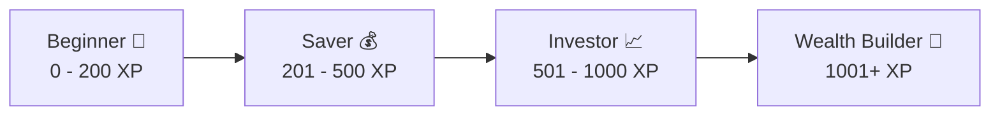

# 📊 FinQuest — Project Progress & Architecture Documentation

> **Last Updated**: November 2026  
> **Status**: Core MVP & Advanced Feature Suite Fully Operational  
> **Repository**: `Finquest`  
> **Target Audience**: Students, Young Adults, and Early-Career Professionals (India-First & Global)

---

## 📌 1. Project Overview & Mission

**FinQuest** is a modern, gamified financial literacy and wealth-building web application—often described as **"Duolingo for Personal Finance"**. 

Traditional personal finance education is often perceived as dry, intimidating, or filled with complex jargon. FinQuest solves this by turning personal finance education into an addictive, habit-forming quest loop. Learners absorb high-impact money management principles through bite-sized lessons, interactive quizzes, streak mechanics, goal-oriented savings trackers, dual-language localization (English and Hinglish), and an AI-powered conversational financial advisor (**FinBot**).

---

## 🏗️ 2. High-Level System Architecture

FinQuest employs a streamlined full-stack architecture coupling a modern React single-page application with a high-performance Express server and a resilient hybrid storage engine.

```
┌────────────────────────────────────────────────────────────────────────┐
│                        CLIENT LAYER (React 19)                         │
│  ┌───────────────────────┐  ┌───────────────────────┐  ┌────────────┐  │
│  │     AuthContext       │  │    HinglishContext    │  │  XP Toast  │  │
│  │ (JWT & User Session)  │  │ (EN / Hinglish State) │  │  Engine    │  │
│  └───────────┬───────────┘  └───────────┬───────────┘  └─────┬──────┘  │
│              │                          │                    │         │
│  ┌───────────▼──────────────────────────▼────────────────────▼──────┐  │
│  │  Pages: Home | Dashboard | Lessons | Detail | Quiz | Tracker    │  │
│  │         Leaderboard | GoalSetup | Login | Signup                 │  │
│  └──────────────────────────────────┬───────────────────────────────┘  │
└─────────────────────────────────────┼──────────────────────────────────┘
                                      │ REST API / JSON (Axios/Fetch)
┌─────────────────────────────────────▼──────────────────────────────────┐
│                   BACKEND ENGINE (Node.js & Express)                   │
│  ┌────────────────────────┬─────────────────────────────────────────┐  │
│  │ JWT Authentication     │ Express REST Endpoints                  │  │
│  │ & Bcrypt Password Hash │ (/api/auth, /api/goals, /api/lessons,   │  │
│  │ Middleware             │  /api/quiz, /api/leaderboard, /chat)    │  │
│  └───────────┬────────────┴─────────────────────┬───────────────────┘  │
│              │                                  │                      │
│  ┌───────────▼────────────┐        ┌────────────▼───────────────────┐  │
│  │ FinBot AI Engine       │        │ JsonDatabase Service Engine    │  │
│  │ Google Gemini 2.5 SDK  │        │ (Atomic File I/O + In-Memory)  │  │
│  │ + Rule-based Fallback  │        └────────────┬───────────────────┘  │
│  └────────────────────────┘                     │                      │
└─────────────────────────────────────────────────┼──────────────────────┘
                                                  │ Dual-write / Fallback
┌─────────────────────────────────────────────────▼──────────────────────┐
│                         DATA PERSISTENCE                               │
│  ┌───────────────────────────────┐   ┌──────────────────────────────┐  │
│  │ Local JSON Database           │   │ Google Cloud Firestore       │  │
│  │ (data/db.json)                │◄──┤ (Optional GCP/Firebase Admin)│  │
│  └───────────────────────────────┘   └──────────────────────────────┘  │
└────────────────────────────────────────────────────────────────────────┘
```

---

## 🛠️ 3. Technology Stack Breakdown

| Layer | Technologies & Libraries | Purpose |
| :--- | :--- | :--- |
| **Frontend Framework** | **React 19.0.1** | Modern, declarative component hierarchy with concurrent rendering capabilities. |
| **Language & Typings** | **TypeScript 5.8.2** | Strict end-to-end type safety across both frontend and backend models. |
| **Build & Tooling** | **Vite 6.2.3** & **Esbuild 0.25** | Sub-millisecond HMR during development; optimized CJS bundle compilation for production. |
| **Styling & Design** | **Tailwind CSS v4** (`@tailwindcss/vite`) | Ultra-responsive, dark-themed cybernetic aesthetic with custom neon accents. |
| **Animations & UI** | **Motion** (`motion/react`), **Lucide React**, **Canvas Confetti** | Smooth transitions, iconography, and visual celebration effects on achievement unlocks. |
| **Server Framework** | **Express 4.21.2** with `tsx` runtime | REST API routing, authentication middleware, and development SPA middleware mounting. |
| **Authentication** | **JSON Web Tokens (JWT)** & **Bcrypt.js** | Stateless bearer token auth, token verification, and salted password hashing. |
| **AI Integration** | **Google Gemini AI** (`@google/genai` v2.4.0) | `gemini-2.5-flash` model integration for real-time contextual financial assistance. |
| **Persistence** | File-backed JSON (`data/db.json`) + **Firebase Admin SDK** (`firestore`) | Zero-friction local-first database with automatic synchronization to cloud Firestore. |

---

## 🎮 4. The Gamification Economy (XP & Progression System)

The gamification architecture is designed to reward consistent financial discipline and learning engagement.

### XP Earning Matrix
| Action | XP Reward | Frequency / Trigger |
| :--- | :--- | :--- |
| **New Account Registration** | `+50 XP` | One-time sign-up bonus |
| **Daily Check-in / Login** | `+10 XP` | Awarded once every 24-hour cycle upon app launch |
| **Completing a Financial Lesson** | `+50 XP` | Awarded per unique lesson completed |
| **Quiz Correct Answer** | `+30 XP` per question | Up to `+90 XP` per 3-question quiz |
| **Daily Habit Challenge** | `+25 XP` | Awarded on completing a daily micro-action |
| **Initial Goal Setup Wizard** | `+30 XP` | Awarded upon defining onboarding goals |
| **Adding a New Custom Goal** | `+30 XP` | Awarded whenever a new financial goal is configured |
| **Depositing Savings into a Goal** | `+20 XP` | Awarded whenever money is logged into a savings target |

### Rank & Level Hierarchy
Ranks are calculated dynamically using the `calculateLevelTitle` utility based on accumulated XP:



---

## 🚀 5. Detailed Feature Implementation Status

### ✅ Feature 1: Dual-Language Engine (English & Hinglish)
- **Status**: **100% Complete & Integrated**
- **Details**:
  - Global toggle available in the header bar with instant language switching.
  - Persisted in browser `localStorage` (`finquest_hinglish`).
  - Helper function `t(englishString, hinglishString)` translates UI strings, lesson texts, daily challenges, and quiz questions.
  - Conversational Hinglish tailored to young Indian savers (e.g., *"Paisa save karna mushkil nahi hai!"*).

### ✅ Feature 2: 120 Interactive Bite-Sized Lessons
- **Status**: **100% Complete & Populated**
- **Details**:
  - Curated across 6 data sets (`BASE_LESSONS`, `LESSONS_BATCH_1` through `LESSONS_BATCH_5`).
  - Covers **15 core financial categories**:
    1. **Budgeting** (50/30/20 rule, zero-based budgeting, tracking money leakage)
    2. **Saving** (Emergency funds, high-yield savings accounts, automation)
    3. **Investing** (Equity mutual funds, SIPs, Index funds, compounding)
    4. **Tax** (Old vs. New Tax Regime, Section 80C, 80D, ELSS, Capital Gains)
    5. **Insurance** (Pure Term Insurance, Health Insurance Super Top-ups)
    6. **Goals** (SMART goals, short-term vs. long-term asset allocation)
    7. **Security** (Cyber scams, UPI fraud prevention, 2FA, identity safety)
    8. **Debt** (Good debt vs. bad debt, snowball vs. avalanche payoff methods)
    9. **Real Estate** (Renting vs. buying, REITs, home loan interest calculations)
    10. **Crypto** (Blockchain basics, volatility, 30% VDA taxation in India)
    11. **Career** (Negotiating compensation, CTC vs. in-hand salary, PF/ESOPs)
    12. **Retirement** (NPS, PPF, FIRE calculation, 4% safe withdrawal rule)
    13. **Entrepreneurship** (Side hustles, bootstrapping, cash flow management)
    14. **Banking** (Credit scores / CIBIL, credit card reward maximization)
    15. **Economics** (Inflation, repo rate, interest rate cycles, purchasing power)
  - Interactive Duolingo-style tree map (`ProgressMap.tsx`) with status indicators:
    - 🟢 **Completed Node**: Green gradient with checkmark icon.
    - 🟣 **Active Current Node**: Glowing, pulsing purple gradient with play icon.
    - ⚪ **Locked Node**: Translucent card with padlock icon.

### ✅ Feature 3: Interactive Knowledge Checks (Quizzes)
- **Status**: **100% Complete & Integrated**
- **Details**:
  - Every lesson features a contextual 3-question MCQ quiz.
  - Bilingual questions, multiple-choice options, and comprehensive answer rationales.
  - Instant visual feedback on selected options (green for correct, red for incorrect).
  - Score tabulation, automated XP crediting via `/api/quiz/:lessonId/submit`, and celebratory **canvas-confetti** particle explosion on quiz completion.

### ✅ Feature 4: FinQuest Money Tracker & Goal Engine
- **Status**: **100% Complete & Integrated**
- **Details**:
  - Categorized goal tracking: Short-Term (<= 12 months) and Long-Term (> 12 months).
  - Built-in goal category presets:
    - *Emergency Fund 🛡️*
    - *Goa Vacation Trip ✈️*
    - *New Smartphone / Laptop 💻*
    - *Car Down Payment 🚘*
    - *Gold & Mutual Funds 📈*
  - Interactive Goal Meters (`GoalMeter.tsx`):
    - Circular SVG animated progress meters for short-term targets.
    - Linear gradient meters with projected completion dates for long-term targets.
    - Dynamic Indian Rupee formatting (`₹1,00,000`).
  - Add Savings Modal (`AddSavingsModal.tsx`):
    - Logs savings deposits with custom memo/notes.
    - Updates goal progress in real time and triggers `+20 XP` toast notification.
  - Add Custom Goal Modal (`AddGoalModal.tsx`):
    - Allows creating unlimited additional short/long-term goals with custom icons and categories.
  - Delete goal capability with automatic recalculation.

### ✅ Feature 5: Daily Micro-Habit Challenges & Streak Tracking
- **Status**: **100% Complete & Integrated**
- **Details**:
  - Rotating micro-action prompts (e.g. *"Avoid food delivery today 🍱"*, *"Track every single expense 📝"*, *"Save ₹100 today 💰"*).
  - Streak flame badge (`StreakBar.tsx`) tracking consecutive days of activity.
  - Daily login streak validation logic automatically increments streaks or resets them if a day is skipped.

### ✅ Feature 6: FinBot AI Conversational Advisor
- **Status**: **100% Complete & Operational**
- **Details**:
  - Floating slide-out drawer accessible from any authenticated screen.
  - Backed by **Google Gemini 2.5 Flash** (`@google/genai`) via `/api/chat`.
  - Tuned with a custom system prompt to provide concise, friendly, emoji-rich financial guidance in English or Hinglish.
  - Built-in smart fallback heuristics when API keys are not supplied (answers iPhone affordability questions, 50/30/20 budget allocations, SIP mechanics, Section 80C tax rules).
  - Quick-prompt chips for one-click questions.

### ✅ Feature 7: Champions Leaderboard
- **Status**: **100% Complete & Operational**
- **Details**:
  - Global Top 10 rankings sorted descending by total XP.
  - Custom medal indicators for podium finishes (🥇 1st, 🥈 2nd, 🥉 3rd).
  - Highlighted row for the currently authenticated user (`isCurrentUser`).
  - Live statistics showing user avatars, streaks, level titles, and XP scores.

### ✅ Feature 8: User Authentication & State Management
- **Status**: **100% Complete**
- **Details**:
  - Full JWT-based auth flow (`/api/auth/signup`, `/api/auth/login`, `/api/auth/me`).
  - Password encryption using salted bcrypt hashes.
  - Pre-seeded test accounts available (`rahul@finquest.com`, `pooja@finquest.com` with demo password `password123`).
  - SVG emoji avatar generator with randomized palettes.

---

## 🗂️ 6. Directory Structure & Key Files

```
Finquest/
├── data/
│   └── db.json                         # Embedded persistent JSON store (Users, Lessons, Quizzes, Goals)
├── server/
│   ├── db.ts                           # Database service layer, level title logic, Firestore bridge
│   ├── firebase.ts                     # Optional Firebase Admin SDK initialization
│   └── middleware/
│       └── auth.ts                     # Express JWT token verification middleware
├── src/
│   ├── components/                     # Modular Reusable UI Components
│   │   ├── AddGoalModal.tsx            # Modal to configure new short or long-term goals
│   │   ├── AddSavingsModal.tsx         # Modal to deposit money into existing goals
│   │   ├── DailyChallengeCard.tsx      # Daily micro-habit challenge widget
│   │   ├── FinBotDrawer.tsx            # Floating AI advisor conversational drawer
│   │   ├── GoalMeter.tsx               # Circular & linear goal visual progress meters
│   │   ├── LessonCard.tsx              # Lesson overview card with category badge & read time
│   │   ├── Logo.tsx                    # FinQuest brand identity logo
│   │   ├── Navbar.tsx                  # Top sticky navigation bar with language & profile toggles
│   │   ├── ProgressMap.tsx             # Duolingo-style serpentine path progression map
│   │   ├── QuizCard.tsx                # Interactive MCQ quiz component with confetti
│   │   ├── StreakBar.tsx               # Daily login streak flame counter
│   │   └── XPBar.tsx                   # User XP level indicator with progress to next rank
│   ├── context/
│   │   ├── AuthContext.tsx             # Authentication, session tokens, and XP toast triggers
│   │   └── HinglishContext.tsx         # English/Hinglish localization state & translator
│   ├── data/
│   │   ├── initialData.ts              # Primary seed definitions (Base lessons, leaderboard, challenges)
│   │   ├── lessonsBatch1.ts            # Lessons 11 - 32 (Budgeting, Debt, Banking)
│   │   ├── lessonsBatch2.ts            # Lessons 33 - 54 (Investing, Stock Market, Equity)
│   │   ├── lessonsBatch3.ts            # Lessons 55 - 76 (Tax Planning, Deductions, Regimes)
│   │   ├── lessonsBatch4.ts            # Lessons 77 - 98 (Real Estate, Insurance, Retirement)
│   │   └── lessonsBatch5.ts            # Lessons 99 - 120 (Crypto, Economics, Career Growth)
│   ├── pages/                          # Screen Views
│   │   ├── Dashboard.tsx               # Main authenticated hub with daily quest & overview
│   │   ├── GoalSetup.tsx               # Step 2 onboarding wizard to define savings targets
│   │   ├── Home.tsx                    # High-conversion dark landing page
│   │   ├── Leaderboard.tsx             # Top 10 champions leaderboard standings
│   │   ├── LessonDetail.tsx            # Bite-sized lesson reader with key takeaways
│   │   ├── Lessons.tsx                 # Category-filtered catalog & tree progress view
│   │   ├── Login.tsx                   # User login screen with demo credentials shortcut
│   │   ├── Quiz.tsx                    # Standalone knowledge assessment wrapper
│   │   ├── Signup.tsx                  # New user onboarding screen
│   │   └── Tracker.tsx                 # Full financial tracker & goal management dashboard
│   ├── utils/
│   │   ├── api.ts                      # Client-side API service methods with JWT injection
│   │   └── avatar.ts                   # Dynamic SVG emoji avatar generator
│   ├── App.tsx                         # Core client router, layout, and footer navigation
│   ├── index.css                       # Tailwind CSS v4 directives & font imports
│   ├── main.tsx                        # React 19 root bootstrap
│   └── types.ts                        # TypeScript interfaces (User, Lesson, Goal, Transaction)
├── .env.example                        # Environment variable template
├── firebase-applet-config.json         # Firebase project configuration metadata
├── firebase-blueprint.json             # Schema entity definition blueprint
├── firestore.rules                     # Cloud Firestore security rules
├── index.html                          # HTML5 shell entry point
├── package.json                        # NPM package configuration & scripts
├── README.md                           # Public repository overview
├── seed.ts                             # Standalone script to populate data/db.json
├── server.ts                           # Express server entry point & API route declarations
├── tsconfig.json                       # TypeScript compiler configuration
└── vite.config.ts                      # Vite build & plugin configurations
```

---

## 📡 7. REST API Endpoints Specification

| Method | Endpoint | Protection | Description |
| :--- | :--- | :--- | :--- |
| `POST` | `/api/auth/signup` | Public | Register new user; returns JWT token + user profile (`+50 XP`). |
| `POST` | `/api/auth/login` | Public | Authenticate existing user; updates daily streak. |
| `GET` | `/api/auth/me` | Bearer JWT | Fetch authenticated user profile & refresh active streak (`+10 XP`). |
| `GET` | `/api/lessons` | Public | Retrieve all 120 lessons with quiz metadata. |
| `POST` | `/api/lessons/:id/complete`| Bearer JWT | Mark lesson complete; awards lesson XP (`+50 XP`). |
| `POST` | `/api/quiz/:lessonId/submit`| Bearer JWT | Submit quiz answers; validates correctness (`+30 XP` per correct answer). |
| `POST` | `/api/goals/setup` | Bearer JWT | Initial setup of short-term and long-term goals (`+30 XP`). |
| `POST` | `/api/goals/add` | Bearer JWT | Add a new custom financial goal (`+30 XP`). |
| `DELETE`| `/api/goals/:goalId` | Bearer JWT | Delete an existing goal. |
| `POST` | `/api/goals/add-savings` | Bearer JWT | Log a savings transaction towards a goal (`+20 XP`). |
| `POST` | `/api/user/daily-challenge`| Bearer JWT | Mark daily challenge complete (`+25 XP`). |
| `GET` | `/api/leaderboard` | Public | Get top 10 ranked learners sorted by XP. |
| `POST` | `/api/chat` | Public | Query FinBot AI (Gemini 2.5 Flash / Smart Heuristic). |
| `POST` | `/api/seed` | Public | Re-seed `data/db.json` with fresh default datasets. |

---

## ⚙️ 8. Local Setup & Execution Guide

### Prerequisites
- **Node.js**: v18.0.0 or higher
- **npm** or **bun**

### Installation & Launch
```bash
# 1. Install dependencies
npm install

# 2. Configure environment
cp .env.example .env
# Edit .env with your GEMINI_API_KEY and JWT_SECRET if desired

# 3. Seed database (Optional - auto-seeds on first boot)
npm run seed

# 4. Start development server (Express + Vite on http://localhost:3000)
npm run dev

# 5. Type-check codebase
npm run lint

# 6. Build for production
npm run build
npm run start
```

---

## 🗺️ 9. Current Status & Future Roadmap

```
  Phase 1: Foundation (COMPLETED)
  ├── [x] Project architecture & Express-Vite integration
  ├── [x] Complete TypeScript schemas & data models
  ├── [x] JWT Auth with salted bcrypt password hashing
  └── [x] Embedded JSON database engine with auto-fallback

  Phase 2: Content & Core Loop (COMPLETED)
  ├── [x] 120 Full Lessons across 15 Financial Domains
  ├── [x] Complete Dual-Language English & Hinglish localization
  ├── [x] S-curve Duolingo-style visual learning path
  ├── [x] Contextual 3-question MCQ quizzes with confetti effects
  └── [x] Gamified XP economy & rank title calculations

  Phase 3: Money Tracker & AI Advisor (COMPLETED)
  ├── [x] Multi-goal savings tracker (Short & Long-term + Custom)
  ├── [x] Interactive SVG circular & linear goal meters
  ├── [x] Savings deposit logging with XP rewards
  ├── [x] Google Gemini 2.5 Flash integration in FinBot
  ├── [x] Smart offline heuristic fallback for FinBot
  └── [x] Global Champions Leaderboard

  Phase 4: Future Horizons & Enhancements (UPCOMING)
  ├── [ ] Visual Expense Analytics & Pie Charts (Recharts / Chart.js)
  ├── [ ] SIP & Compound Interest Interactive Calculator tool
  ├── [ ] Social Features: Friend challenges & 1v1 Quiz Duels
  ├── [ ] Automated Bank SMS / UPI transaction receipt parser
  ├── [ ] Push Notifications / WhatsApp daily streak reminders
  └── [ ] PWA (Progressive Web App) offline caching support
```

---

## 📋 Summary Table of Milestones

| Milestone | Target | Delivery Status | Notes |
| :--- | :--- | :--- | :--- |
| **Authentication System** | Signup, Login, JWT, Bcrypt | 🟢 **Complete** | Demo accounts pre-seeded |
| **Content Library** | 120 Financial Lessons | 🟢 **Complete** | Spans 15 categories with Hinglish |
| **Quiz Engine** | MCQs, Explanations, Confetti | 🟢 **Complete** | Dynamic scoring & XP crediting |
| **Savings Goal Tracker** | Goal creation, deposit logs, meters | 🟢 **Complete** | Visual circular & linear meters |
| **FinBot AI Assistant** | Gemini 2.5 Flash + fallback | 🟢 **Complete** | Contextual financial advice drawer |
| **Gamification Loop** | XP, Streaks, Levels, Leaderboard | 🟢 **Complete** | Real-time toasts & Top 10 rankings |
| **Codebase Health** | Strict TypeScript check (`npm run lint`)| 🟢 **Passes (0 errors)**| Fully typed with `tsc --noEmit` |

---
*Document generated for the FinQuest Project Repository. Maintained by the core development team.*

